# Availability architecture map

## Baseline and limits

Audited `origin/master` at `4332732977ac414b051c0e2308e142af9c5803af` (2026-11-13). The default checkout was dirty, so work was done in a detached isolated worktree. No watchlist rows or credentials were read; no external requests were made. This map distinguishes the implementation contract from current database state: the local PostgreSQL server is available, but it was not queried for user/title rows or runtime source enablement.

## End-to-end path

```mermaid
flowchart LR
  A[External API / provider catalogue] --> B[Source client]
  B --> C[Source adapter normalization]
  C --> D[AvailabilityRefreshService]
  D --> E[Provider identity resolution]
  E --> F[ProviderContent / ContentMapping / Offer]
  F --> G[Reconciliation and freshness]
  G --> H[Canonical AvailabilityQueryService]
  H --> I[OfferEvidence: current / last-known]
  I --> J[Entitlement + language + country/VPN]
  J --> K[Ranking]
  K --> L[API serializers]
  L --> M[Watchlist / catalog / detail frontend]
```

## Components and field provenance

| Stage | Main code / model | Fields and source of truth | Assertions vs inference |
|---|---|---|---|
| HTTP and API envelope | `availability/sources/*_client.py` | status, payload, provider-native IDs, source timestamps, source errors | HTTP success is transport evidence only; schema validation varies by client. Clients must raise on auth, quota, transport and malformed responses rather than emit empty availability. |
| Adapter and normalization | `availability/sources/*.py`, `availability/services/normalize.py`, domain `DiscoveredContent` / `ProviderOffer` | provider content ID, title, release date, media type, country, offer type, URL, price, languages, rights provenance | Provider IDs/types/offer types are source assertions mapped to canonical vocabularies. Missing audio/subtitle values are unknown; `Watchmode` declares `supports_languages=False`. A supported language field does not mean every row contains evidence. |
| Source registration / policy | `availability/sources/__init__.py`, `sources/registry.py`, `tracker/services/source_policy.py` | registered slug, capability declaration, scheduling role | Registration is code-defined. Runtime `Source.enabled` is DB state and was not queried. Roles are explicit: collector / broad aggregator / metered aggregator. |
| Title/provider identity | `availability/services/refresh.py::_resolve_content`, `_provider`; `tracker.Movie`; `Provider`; `ExternalProviderMapping`; `ProviderContent`; `ContentMapping` | TMDb ID/media namespace, canonical provider ID, provider-native content ID, market-specific mapping | JustWatch: market mapping → unscoped mapping → static package mapping → enabled provider slug. Watchmode: known provider ID/name mapping; unknown provider skipped. TMDb identity is source supplied only when capability says so; otherwise matching/mapping must resolve before canonical title offers are trusted. Candidate identity is not automatically verified identity. |
| Canonical persistence | `availability/models.py` (`Offer`, `ProviderContent`, `ContentMapping`, `SyncCursor`, `SyncRun`); `availability/services/refresh.py` | country, offer type, URL, language fields, `last_seen`, availability interval, active state, source, confidence/evidence, rights data | Only canonical rows flow through `AvailabilityQueryService`; legacy rows enter via the legacy ingest bridge. Unknown provider IDs are skipped. Source country/media capability constrains accepted results. |
| Refresh evidence | `availability/freshness.py`; `tracker.RefreshRequest`, `AvailabilityRefresh`, `RefreshRun`; `tracker/services/refresh_requests.py`, `bulk_refresh.py` | per-source observed time, request state/outcome, country/source scope, retries/error, attempt ledger | Positive observations are current only inside freshness windows and if currently available. Failed/unsupported/quota outcomes are not evidence of absence. Aggregator absence is non-authoritative. See discrepancy A3 for queue-derived negative semantics. |
| Evidence read | `tracker/services/availability_reads.py`; `availability/services/catalogue_query.py`, `availability/domain/reconciliation.py` | active offer, current vs stale/unverified evidence, merged source facts | Current verified rows enter the primary offers list; stale/uncorroborated rows are “last known” history. Reconciliation merges evidence and source priority but cannot turn missing territorial/language evidence into source assertions. |
| Access and language | `tracker/services/access.py`, `score.py`, `preferences.py`, `tracker.Subscription`, `Preference`, `Provider` | owned provider/access mode, add-on parent, user language rule/audio/subtitle preferences, current country, configured VPN regions, offer territory scope | Subscription entitlement is exact canonical slug matching with curated aliases. Add-on needs both base and add-on. `rent`/`buy` are separate. Missing language metadata returns unknown (`score.py`); it does not qualify as a language match. Country is a user setting, never inferred from IP/locale. Known offer countries are evaluated against local/VPN reach; blank country without explicit worldwide scope is unknown. |
| Ranking | `tracker/services/ranking.py`, `tracker/services/access.py::resolve_title`, `tracker/services/score.py` | language score, quality, source/provider priorities, locality, entitlement | Ranking orders eligible offers; it must not create entitlement, territorial rights, language matches, or freshness. The main verdict resolves from shared access classifier. |
| API/UI | `tracker/views.py`, serializers; frontend watchlist/catalog/movie/tv pages | `offers`, `last_known_offers`, `watchability`, `availability`, pending/refresh state, localized labels | Watchlist passes aggregated refresh state. Detail invokes shared resolver but currently omits refresh state (A4). Frontend labels and filters are presentation only; API evidence is authoritative for verdict. |

## Authority and offer lifecycle

- **First-party/direct collectors** assert a provider's own catalogue items for declared provider/country scopes. Catalogue membership is not itself entitlement; the canonical offer type and user subscription/access mode decide that.
- **JustWatch and Watchmode** are multi-provider discovery/availability aggregators. They can add or refresh offers but set `supports_authoritative_snapshots=False`; their silence must not deactivate independent positive offers.
- **Streaming Availability** is a metered multi-provider title source. Its positive offers are discoveries, not authoritative negatives. Cache/freshness and `AVAILABILITY_CONSULT_METERED_ONLY_WHEN_UNRESOLVED` control whether a call is scheduled; the gate defaults off in this baseline.
- **Public Domain Archive** may assert an offer only with rights evidence for that territory. Unknown territorial scope is retained as discovery evidence and emits no confirmed offer (`public_domain_archive.py:16-20`). Its canonical provider provisioning is incomplete in code (A5).
- **Legacy scraper rows** are ingested through the bridge and marked as unverified/legacy evidence where configured. Scraper provenance is independent of territory. The canonical scrape country comes from `ProviderContent.metadata.country_code`; blank remains unknown unless an explicit worldwide scope is supplied.
- Offers are upserted, marked unseen, reconciled and deactivated only where source snapshot authority and completeness permit. Incomplete/partial catalogue scans must not deactivate unseen offers. Aggregator omission and request failure are non-authoritative. See `availability/services/refresh.py` and `availability/domain/reconciliation.py`.

## Unknown-to-positive conversion hazards

1. Missing country without explicit worldwide evidence becomes `UNKNOWN`. `is_scraped_source` is provenance only; a known country is always checked against current-country/VPN reach. Only `territorial_scope="worldwide"` becomes `ANYWHERE` (A1 fix plus PR follow-up).
2. Unknown offer type becomes `AccessType.UNKNOWN`, and does not meet included access types; that path fails closed.
3. Unknown language stays `None` in the score, and cannot make `is_accessible=True`; that path fails closed.
4. Unknown provider mapping is skipped rather than auto-created; public archive's missing seed therefore loses coverage rather than fabricating identity.
5. Empty request evidence is dangerous when queue state is summarized as checked regardless of source/country/outcome (A3).
6. Current vs stale evidence is split before ranking; `last_known_offers` is history, not current availability.
7. VPN reach requires `Preference.vpn_enabled=True`. When enabled, a nonempty `candidate_countries` list restricts reachable VPN regions; an empty list means any nonlocal country. Saved candidate regions do not activate VPN while the switch is off.

## Surfaces to keep consistent

- Watchlist report: `tracker/views.py::watchlist_report` → `apply_composable_filters` → `evaluate_watchability` → `resolve_title`.
- Detail: `movie_detail` / `tv_detail` → `get_offer_evidence` → `resolve_title` → `qualify_watchability_dict`.
- Unified catalog: `tracker/services/unified_catalogue.py`, catalogue query/read boundary and user preference filters.
- Availability report: `tracker/views.py::availability_report` / `availability_title_report`; source-level observations and resolution reasons, not a replacement for entitlement verdict.
- Legacy movie availability endpoint: `tracker/views.py::movie_availability`; confirm its serializer's stale/refresh labels before presenting it as equivalent to the canonical detail verdict.

The shared `resolve_title` substantially unifies access and ranking, but call-site inputs still matter: refresh-state omission is a demonstrated inconsistency (A4).
