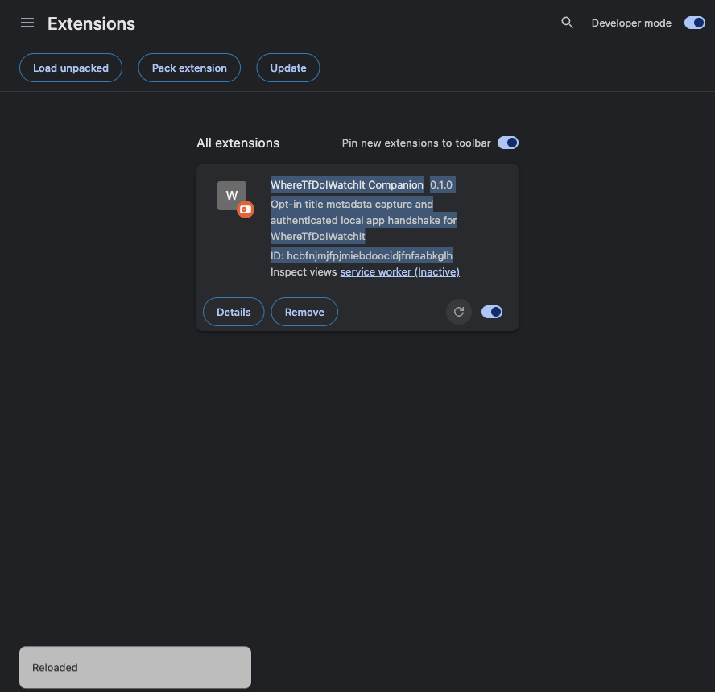
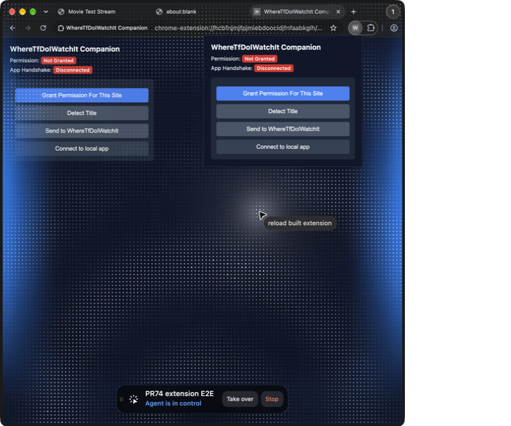
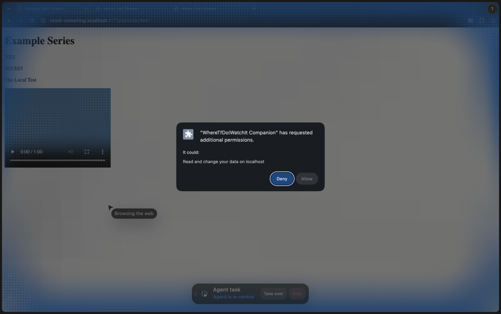

# PR #74 browser extension verification

## Environment

- Repository: `AngeloAndreaIsola/WhereTfDoIWatchIt`
- PR branch under test: `feat/wt-049-extension-foundation-3441011916249609102`
- Isolated checkout: `/Users/angeloandreaisola/Documents/GitHub/WhereTfDoIWatchIt-pr74`
- Base commit before these uncommitted changes: `6ff946d` (merge of latest `origin/master` at `47d78dd`)
- Ego Lite: installed on macOS; Ego browser runtime reported Chromium `156.0.0.0` (`Chrome/156.0.0.0`, macOS user agent `10_15_7`)
- Extension ID: `hcbfnjmjfpjmiebdoocidjfnfaabkglh`
- Package loaded in Ego: `extension/dist/package`
- Local test app: Django on `localhost:8000`; isolated PostgreSQL test database on port `55433`
- Local test site: `mock-streaming.localhost:4173`, with movie and episode pages and a decoded 60-second MP4 in an HTML5 video element

Temporary database credentials and capability tokens are not stored in this repository or this report.

## Build and automated checks

Commands run in `extension/`:

| Command | Result |
| --- | --- |
| `npm run typecheck` | PASS |
| `npm test` | PASS, 29 tests |
| `npm run build` | PASS; emitted package at `extension/dist/package` |
| `npm run validate:package` | PASS |

Backend validation used the isolated Python 3.12 environment and disposable PostgreSQL database:

| Command/check | Result |
| --- | --- |
| `python manage.py migrate` | PASS |
| `python manage.py test tracker.tests.test_extension_api -v 2 --noinput` | PASS, 5 tests |
| Extension CI workflow | Added; GitHub result pending final push |

## Real Ego Lite evidence

These are screenshots captured from the actual Ego Lite window and installed extension, not generated from HTML or test output.

| Evidence | Screenshot |
| --- | --- |
| Installed Manifest V3 extension enabled |  |
| Initial state: supported site not authorized |  |
| User approved access to the selected mock site |  |
| Detect Title read the active movie page |  |
| Video progress displayed at 20% |  |
| Episode title and S2:E3 displayed |  |
| Localhost permission prompt shown by Chromium |  |

The installation page showed the extension enabled and no manifest error banner. The service worker displayed “Inactive” before the first action; it woke for popup actions. The browser version and extension ID above were read from Ego and `chrome://extensions/`.

## Acceptance results

| Criterion | Result | Evidence / remaining work |
| --- | --- | --- |
| 1. Installs without manifest or worker errors | PASS | Installed unpacked MV3 package in Ego; no manifest error banner. Console inspection remains outstanding. |
| 2. Initially no streaming site is authorized | PASS | Real popup showed `Permission: Not Granted` and disabled Detect before opt-in. |
| 3. Opt-in grants only the selected site | PASS | Chromium permission prompt and resulting popup showed permission for the mock fixture site only. |
| 4. Detect reads the active page, not popup DOM | PASS | Real popup extracted “The Test Film” from the active mock movie page. |
| 5. Movie, episode/season, and progress display | PASS | Movie/year, S2:E3, and 20% progress screenshots above. |
| 6. Popup close/reopen preserves intended permission | PASS | Reopened popup retained the mock-site permission state. |
| 7. Local app connection completes explicit approval | BLOCKED | Popup **Connect to local app** action still needs a user click in Ego. The GUI bridge can open the popup but closes it before dispatching a click to popup controls. The user was handed the existing Ego space to click Connect and approve localhost access if prompted. |
| 8. Authenticated ingestion persists expected app result | BLOCKED | Must resume after criterion 7; verify the real popup request and database record. |
| 9. Revocation prevents further extraction | NOT RUN | Must complete via real popup after local app flow. |
| 10. Expiry, revocation, denial, unavailable backend, missing video, unsupported site fail gracefully | PARTIAL | Backend automated tests cover challenge expiry, denied authorization, token expiry/revocation, invalid origin, and unauthorized requests. Ego testing for these failure states remains incomplete; missing-video and unsupported-site browser cases are not yet run. |

## Console and network observations

- No manifest load error was shown by `chrome://extensions/`.
- The initial connection attempt did not create a server-side challenge. The isolated PostgreSQL container had stopped, so the test backend was unavailable during that attempt; the disposable container has since been restarted. No token or user credential was exposed in screenshots.
- A repeated installed-extension authorization and ingestion run is still required after the user completes the popup action. No authenticated request or persisted playback record is claimed as passed yet.
- Ego's computer-use bridge reports the popup as a transient Chromium popup window. Bringing Ego forward closes that popup before its button click is delivered, preventing agent-driven activation of the connection control. This is why criterion 7 is awaiting a manual handoff.

## Limitations and remaining work

- Only `mock-streaming-adapter` for the local fixture is implemented. No production streaming platform is supported.
- The ingestion route persists `ExtensionPlaybackRecord`; it does not resolve metadata into TMDb or assert that a normal watched item was created.
- Complete the manual Ego authorization step, then repeat real-browser connect, send, and persisted-result checks; exercise revocation and graceful failure cases in Ego; capture authorization, connected, and ingestion screenshots; rerun affected checks; inspect final GitHub checks; and update this report with the resulting commit SHA before considering the PR merge-ready.
