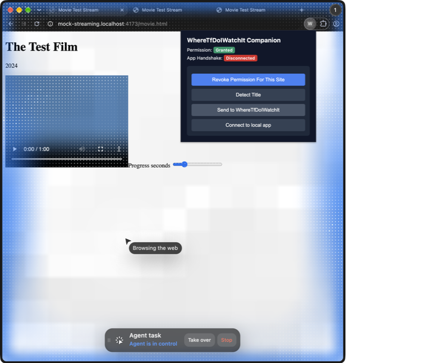
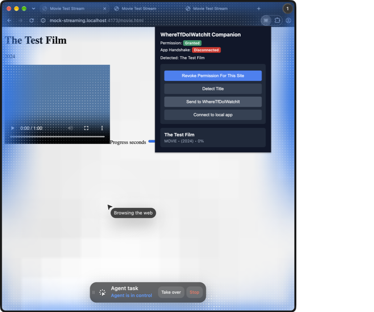
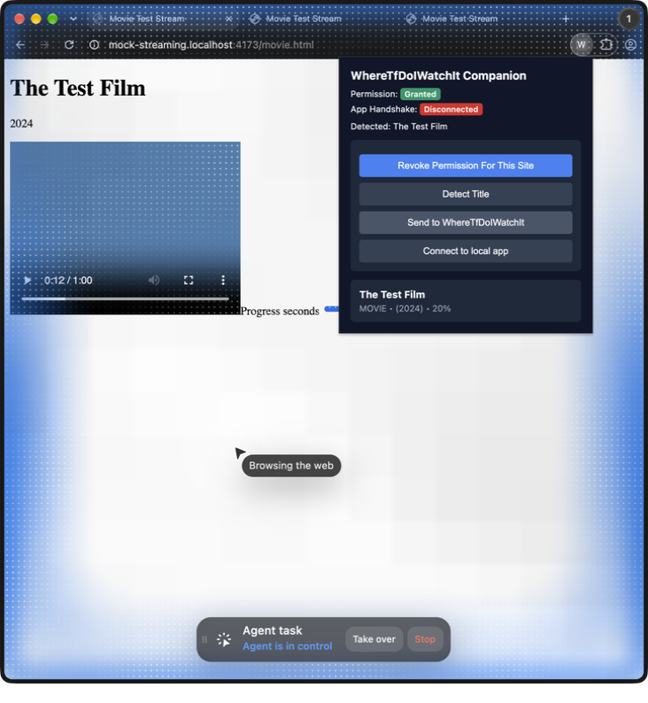
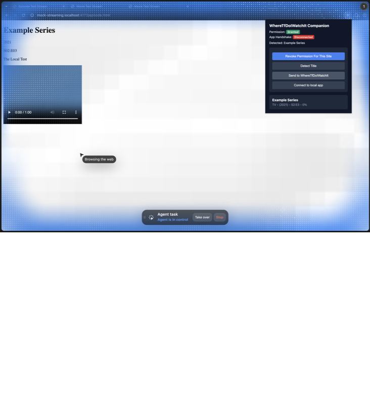
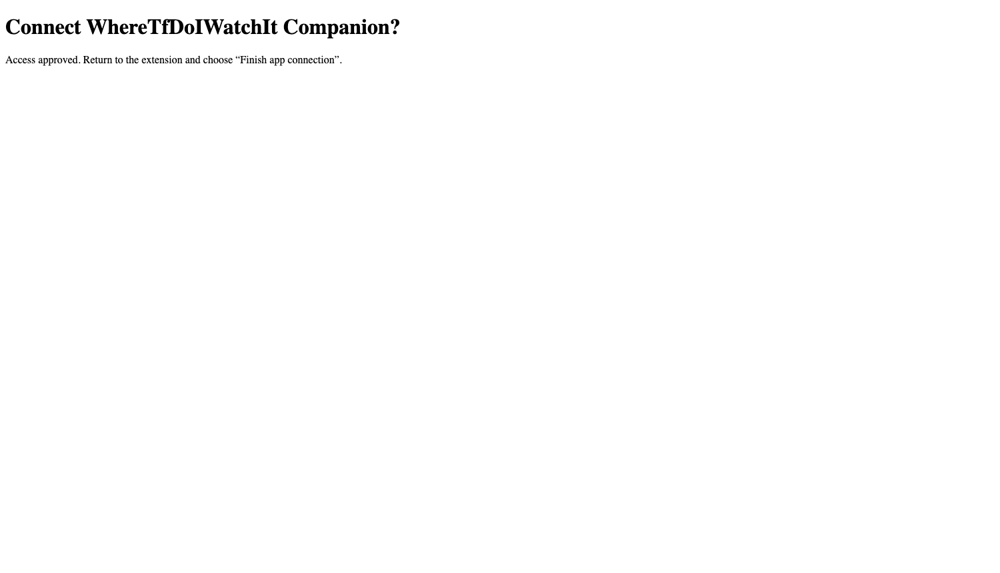
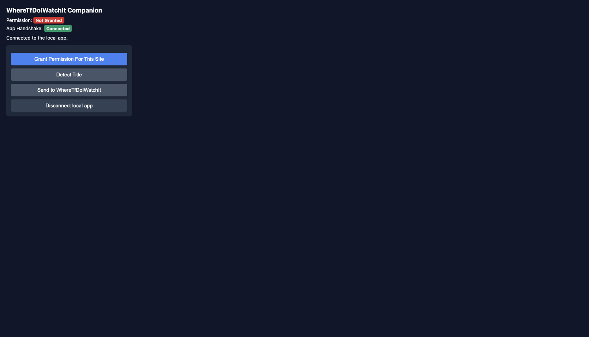
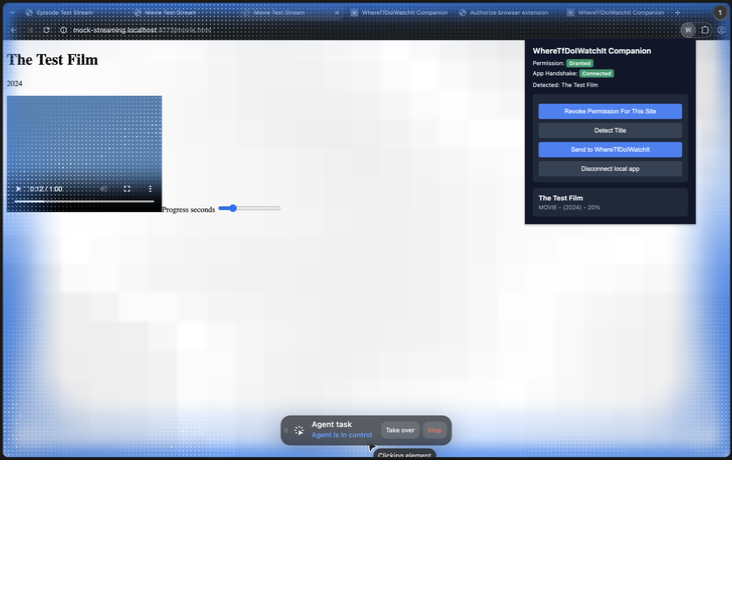
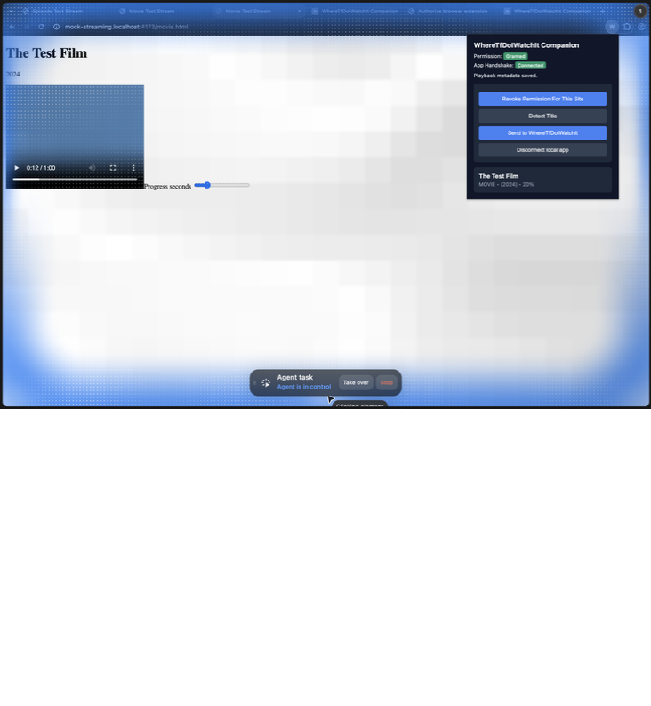
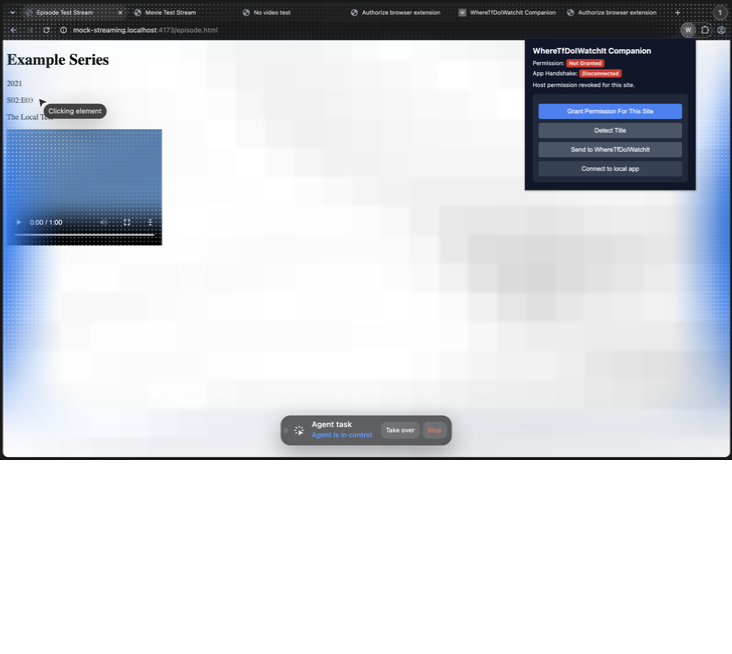
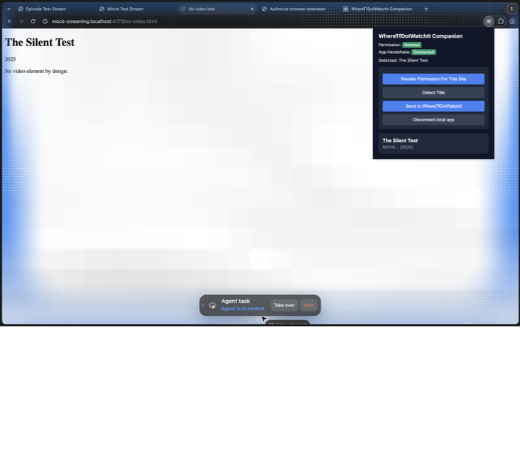

# PR #74 browser extension verification

## Environment

- Repository: `AngeloAndreaIsola/WhereTfDoIWatchIt`
- PR branch: `feat/wt-049-extension-foundation-3441011916249609102`
- Isolated checkout: `/Users/angeloandreaisola/Documents/GitHub/WhereTfDoIWatchIt-pr74`
- Tested code revision: `6eae992` (this report-only correction is committed immediately afterward).
- Ego Lite on macOS, Chromium `156.0.0.0` (`Chrome/156.0.0.0`, user agent platform `10_15_7`)
- Installed unpacked MV3 package: `extension/dist/package`
- Extension ID: `hcbfnjmjfpjmiebdoocidjfnfaabkglh`
- Isolated Django backend: `http://localhost:8003`; disposable PostgreSQL on host port `55433`
- Mock streaming fixture: `http://mock-streaming.localhost:4173`, with movie, episode, no-video, and unsupported-host cases
- The default package connects to `http://localhost:8002` (the repository's Compose backend). For Ego E2E, the package was built with the permitted loopback override to port `8003`, since the user's existing containers already occupied ports `8000`–`8002`.

No temporary credentials, bearer tokens, or real user data are included here.

## Build and automated checks

Commands run from `extension/`:

| Command | Result |
| --- | --- |
| `npm run typecheck` | PASS |
| `npm test` | PASS, 34 tests across 4 files |
| `WTDIW_EXTENSION_LOCAL_APP_ORIGIN=http://localhost:8003 npm run build` | PASS, packaged MV3 output |
| `npm run validate:package` | PASS |
| `frontend: npm test -- --run` | PASS, 274 tests across 33 files |

Backend command, run with the isolated PostgreSQL test database:

| Command | Result |
| --- | --- |
| `python manage.py test tracker.tests.test_extension_api -v 2 --noinput` | PASS, 5 tests: CSRF approval, explicit denial, challenge expiry/origin/nonce binding, scoped token expiry/revocation, unauthorized origin/bearer |
| `python manage.py migrate` | PASS |

The extension CI job runs build, typecheck, unit tests, and package validation. The latest previously pushed revision (`69891e0`) had passing Backend Tests, Frontend Lint/Build/Test, and Browser Extension Build/Typecheck/Tests (GitHub Actions run `43833533630`). CI must be rechecked after this final revision is pushed.

## Ego Lite evidence

Every image below was captured from the installed extension or the local authorization page in Ego Lite.

| Check | Evidence |
| --- | --- |
| Extension installed and enabled |  |
| Initial opt-in state |  |
| Selected-site permission approval |  |
| Movie active-tab extraction |  |
| Movie playback progress at 20% |  |
| TV season and episode |  |
| Local Django authorization approval |  |
| Extension connection completed |  |
| Actual toolbar popup detected the active page |  |
| Actual toolbar popup sent metadata |  |
| Permission revocation disabled extraction |  |
| Missing-video page returned title without fabricated progress |  |

For the local-app flow, the actual installed extension popup opened a CSRF-protected Django approval page. **Allow title metadata** was clicked in Django; returning to the popup and clicking **Finish app connection** produced `App Handshake: Connected`. The popup then sent movie and episode metadata through the authenticated endpoint.

The isolated database contained these results after the real popup sends:

| Title | Kind | Year | Episode | Persisted playback |
| --- | --- | --- | --- | --- |
| The Test Film | Movie | 2024 | — | 12/60 seconds, 20% |
| Example Series | TV | 2021 | S2:E3 | 0/60 seconds, 0% |

Both rows have source URLs from the mock site and `mock-streaming-adapter` as their adapter ID.

## Acceptance results

| Criterion | Result | Evidence / limitation |
| --- | --- | --- |
| 1. Installs without manifest, worker, or console errors | PASS | `chrome://extensions/` showed the package enabled with no manifest error. The inspected service-worker DevTools console showed `0 messages`; the final normal extension page produced no console exceptions. |
| 2. Initially no streaming site authorized | PASS | Real toolbar popup showed `Permission: Not Granted` and disabled Detect before opt-in. |
| 3. Opt-in grants only selected site | PASS | User-approved optional host permission was for the mock fixture host; no all-sites access was added. |
| 4. Detect reads active page, not popup DOM | PASS | Actual action popup extracted `The Test Film` and `Example Series` from active mock tabs. |
| 5. Movie, episode/season, and progress display | PASS | Movie 2024 at 20%; episode S2:E3 at 0%. |
| 6. Popup close/reopen preserves site state | PASS | Reopened popup restored selected-site permission and connected-app state. A browser-only stale Disconnected state when the URL was unavailable was fixed and covered by regression tests; the final installed popup retained Connected while site controls failed closed. |
| 7. Explicit local app connection | PASS | The final installed build completed the normal-tab flow: **Connect to local app**, real Django consent, then **Finish app connection**. The popup showed Connected. |
| 8. Authenticated ingestion persists expected result | PASS | Movie and TV records were verified in isolated PostgreSQL after actual popup sends. |
| 9. Revocation prevents extraction | PASS | Real popup **Revoke Permission For This Site** changed state to Not Granted and disabled Detect/Send. |
| 10. Expired/revoked token, denied permission, unavailable backend, no video, unsupported site | PARTIAL | Expired and revoked tokens returned visible 401 errors; unavailable backend showed `Handshake failed: Failed to fetch`; no-video extraction returned title/year with no fabricated progress; unsupported site showed a message and disabled controls. A real user denial of the browser permission request was not exercised. |

## Console and network observations

- No manifest load error was shown. The service worker was inactive while idle and activated for extension actions.
- Successful extension sends created the two rows above. After revoking the server-side capability, a send attempt showed `Failed to ingest metadata: 401` and cleared the connected state. An expired capability produced the same visible 401 failure.
- With the isolated server stopped, **Connect to local app** showed `Handshake failed: Failed to fetch`; the server was then restarted.
- The initial attempt against a different local service on port `8000` returned HTTP 404. The extension default was corrected to this repository's Compose backend port `8002`; the Ego test build used loopback port `8003` to avoid touching the user's running containers.
- The service-worker DevTools console showed no messages; the normal extension page produced no console exceptions. Screenshots contain no bearer tokens or credentials.
- Initial Ego console-event capture found an uncaught `chrome.tabs.query` rejection when the normal extension page had no active browser window. The popup now catches this and fails closed; an automated regression was added. A second real Ego run of the final package produced no extension-page console exceptions, and the local-app flow still completed.

## Limitations and merge status

- Only the local `mock-streaming-adapter` is implemented and tested. Netflix, Prime Video, and other production streaming sites are not supported.
- No-video pages may still provide title metadata; playback fields are omitted when there is no usable HTML5 video element.
- The Ego run did not exercise a user actively denying the browser host-permission prompt, and did not capture the extension worker DevTools console. Backend tests cover denied local-app authorization, CSRF protection, token expiry/revocation, origin validation, and unauthorized requests.
- The ingestion endpoint persists `ExtensionPlaybackRecord`; it does not resolve the detected metadata into a normal watched-title record.
- **Current verdict: BLOCKED.** Do not merge until a real user denial of the optional site-permission request is exercised and CI passes on the final pushed commit.
